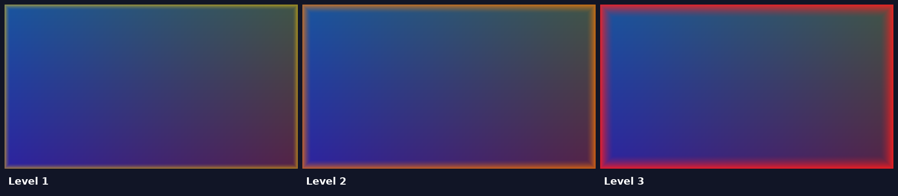

<p align="center"></p>

**English** · [Español](README.es.md)

Inside Voice watches your microphone level while you talk on your PC (games, Discord, calls) and warns you
**visually** when you get too loud: a border appears around your screen and gets stronger the louder you are.
Because the warning is visual, it does not disturb your game or your voice chat.

> *Shh... they can hear you.*

## What the alert looks like



*(Simulation. The real border is drawn over your screen; its look is fully configurable.)*

## Features

- **Progressive alert**: 2 to 4 levels. The louder you are, the thicker, more opaque and faster-blinking the border.
- **Voice filter**: reacts to *voice* only; keyboard, mouse clicks, door slams and fans are ignored.
- **Guided calibration** in a window: talk normally, then louder, and the levels are set for you.
- **Multi-monitor**: pick the monitors that show the alert (works with different resolutions; the border thickness
  is scaled per monitor). An *Identify monitors* button shows a number on each screen.
- **Fully configurable look**: colour per level, thickness, opacity, blink speed and style (soft glow, solid line,
  gradient, corners only, or your own PNG frame). Live preview while you change things.
- **Night mode**: a schedule (hours and weekdays) with a lower threshold, so you are warned earlier at night.
- **Optional soft sound** (off by default).
- **Spanish and English** interface (follows the Windows language, or choose it).
- **Light on resources**: it only measures the microphone level; the border is drawn once per alert and only its
  transparency changes while blinking. Nothing is drawn when there is no alert. The *General* tab shows the CPU
  and RAM the program itself uses.
- **Private**: audio is never stored or sent anywhere; the program has no network code.

## Install (Windows 10/11)

Download `InsideVoice-Setup-<version>.exe` from the
[Releases](../../releases) page (or from the *Artifacts* of the latest successful run in the
[Actions](../../actions) tab), run it and follow the wizard. There is also a portable `.zip`.

The first time it opens a calibration wizard. After that it lives in the system tray (the little ghost next to the
clock): double-click to open the settings, right-click to pause, test the alert or quit.

### Good to know

- The microphone is opened in **shared mode**, so Discord, your game or an AI voice assistant keep working at the same time.
- Games in *exclusive fullscreen* hide any overlay. Use *borderless/windowed fullscreen* to see the border.
- The border is a separate click-through window: it never injects anything into a game.
- Recalibrate if you change the microphone, its gain or the distance to it.
- Blinking is limited (hard on/off is capped at 3 flashes per second). Choose *No blinking* if flashing bothers you.

## Build it yourself

Needs Windows and Python 3.10+ (64-bit):

```bat
build.bat
```

It installs the dependencies, runs the tests and a self-test, builds `dist\InsideVoice\InsideVoice.exe` with
PyInstaller and, if [Inno Setup 6](https://jrsoftware.org/isinfo.php) is installed, the installer in `dist-installer\`.

For development: `pip install -r requirements-dev.txt`, `python -m inside_voice`, `python -m pytest`.
`python -m inside_voice --selftest` checks translations, rendering, monitors, the overlay windows and the settings
window without needing a microphone.

GitHub Actions (`.github/workflows/build.yml`) does the same on every push and publishes the installer as a release
named after the version in `inside_voice/__init__.py` (bump it to publish a new version).

## How it works

```
microphone ─► AudioEngine (16 kHz mono, 50 ms blocks)
                 └► VoiceDetector (level in dB + "is it a voice?")
                       └► Detector (levels, hold/release, hysteresis; night-mode threshold)
                             └► OverlayManager ─► one layered, click-through window per monitor
```

| Module | Role |
| --- | --- |
| `inside_voice/voice_filter.py` | level (dBFS) and speech detection (speech-band energy + pitch periodicity) |
| `inside_voice/detector.py` | turns levels into alert level 0..N |
| `inside_voice/calibration.py` | computes the threshold from the two guided recordings |
| `inside_voice/render.py` | draws the border bitmap and the blink curve |
| `inside_voice/overlay.py` | Win32 layered windows, one thread, 30 Hz timer only while blinking |
| `inside_voice/ui/` | tkinter settings window, calibration wizard |
| `inside_voice/locales/` | `es.json`, `en.json` (add a language by translating one file) |

## Roadmap

See [docs/ROADMAP.md](docs/ROADMAP.md): per-game themes with their own frames and animations, and more.

## License

Inside Voice is free software, released under the **GNU General Public License v3.0 or later** (see [LICENSE](LICENSE)).
You can use, study, share and modify it; if you distribute a modified version it must stay under the same licence
with its source code available.

## Code signing policy

Windows may show a *SmartScreen* warning ("Windows protected your PC") with new, unsigned downloads. Click
**More info → Run anyway**. Releases are built automatically by GitHub Actions from the source in this repository
and contain nothing else. Free code signing is being requested from the SignPath Foundation; this section will
describe the signing policy once it is approved.

## Support

Inside Voice is free. If it is useful to you, you can support its development from the *General → About* tab of the
app (coffee button) or at [ko-fi.com/nachoalba](https://ko-fi.com/nachoalba).
